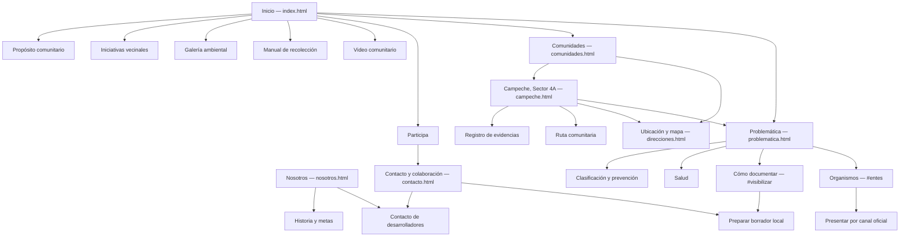
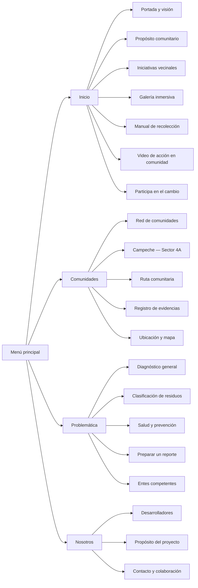
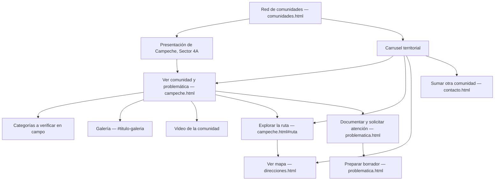
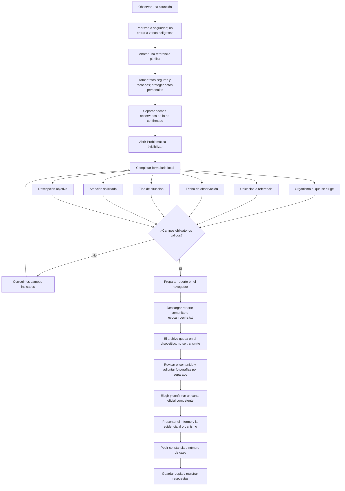
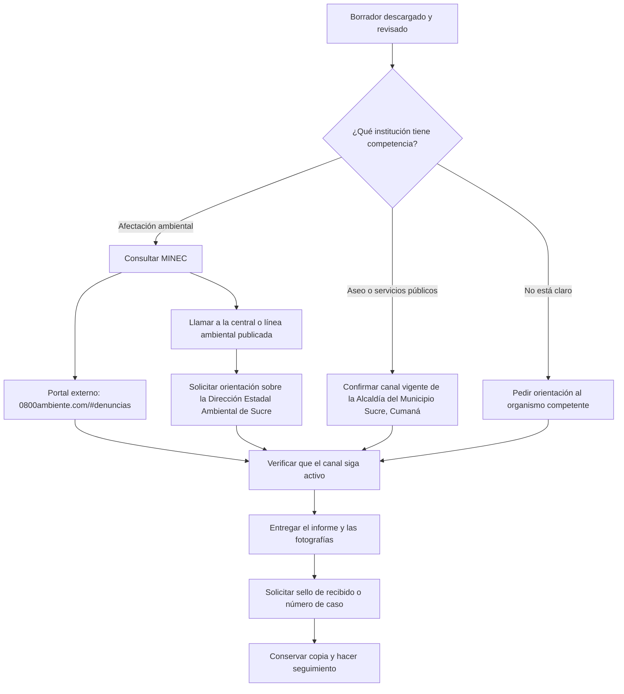

# Navegación y flujos de EcoCampeche

Este documento describe las páginas y los recorridos principales del sitio. Los bloques Mermaid se pueden copiar directamente en [mermaid.live](https://mermaid.live) para verlos o exportarlos.

## 1. Mapa general del sitio

La navegación principal está disponible en todas las páginas. Los enlaces a secciones usan anclas (`#...`) para llevar a una parte concreta de la página indicada.

## 2. Menú principal

El mismo menú se repite en las páginas. En pantallas pequeñas se abre con el botón del encabezado; elegir un enlace o pulsar Escape lo cierra.

## 3. Recorrido de comunidades

La página de comunidades presenta el territorio piloto, una galería carrusel y enlaces al perfil de Campeche, a la ruta y al mapa. Desde el perfil se puede revisar la galería y continuar hacia orientación para preparar un reporte.

## 4. Documentar una situación y preparar el informe

El formulario local de `problematica.html` ayuda a organizar la información. No es un sistema de denuncias: no envía ni almacena el contenido. El archivo descargado debe revisarse, completarse con las evidencias por separado y presentarse ante el organismo competente.

## 5. Presentación por un canal institucional

El enlace al portal del MINEC abre un sitio externo. El teléfono y los demás datos publicados deben confirmarse antes de usarlos. Para asuntos ambientales, la página recomienda pedir orientación sobre el contacto estadal de Sucre. La plataforma EcoCampeche no recibe denuncias.

## Notas de alcance

- Los enlaces a páginas y secciones corresponden a los archivos HTML y anclas que existen actualmente.
- El formulario crea un archivo `.txt` en el navegador; no manda datos a EcoCampeche ni a un organismo.
- Las fotografías se adjuntan por separado cuando se presenta el reporte.
- EcoCampeche es informativo y comunitario; no es un canal oficial ni garantiza una respuesta institucional.
- Confirma la vigencia de teléfonos, portales y competencias antes de enviar información sensible.
