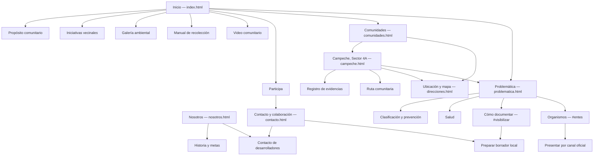
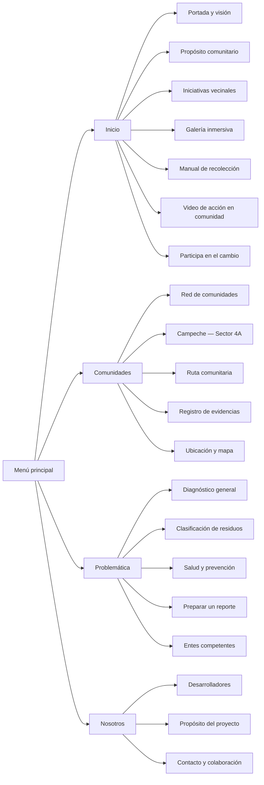
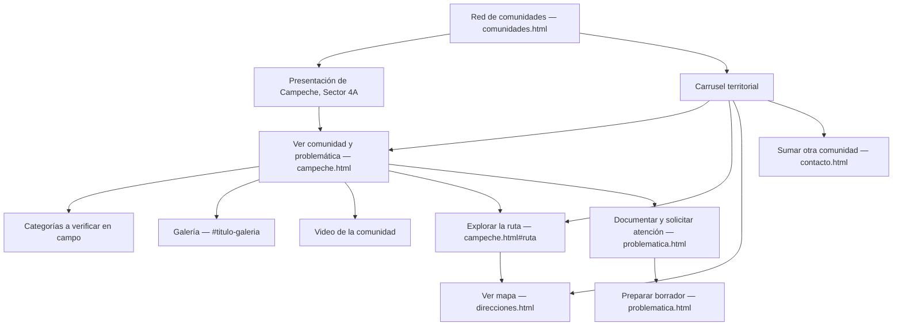
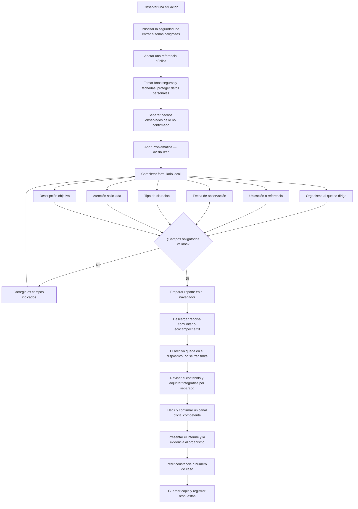
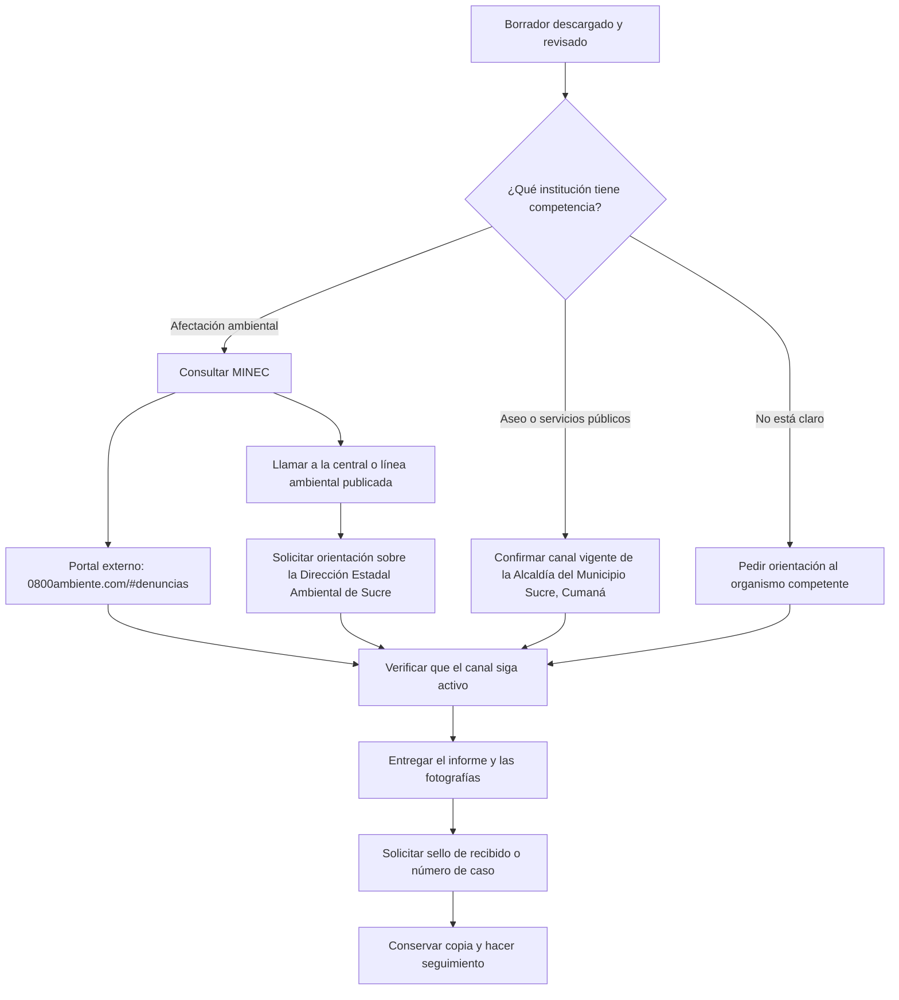

# EcoCampeche

Sitio estático para compartir información sobre residuos sólidos, salud pública y participación comunitaria en Campeche, Sector 4A.

## Páginas

- `index.html`: presentación, información ambiental, reflexión e iniciativas comunitarias.
- `comunidades.html`: comunidad piloto y estructura para sumar otros sectores.
- `campeche.html`: perfil de Campeche, categorías de problemas y galería de referencia.
- `problematica.html`: prevención, riesgos para la salud, guía de documentación y generador local de reportes.
- `direcciones.html`: referencia general de ubicación y búsqueda en mapas.
- `nosotros.html`: equipo desarrollador e historia local.
- `contacto.html`: formas de colaboración y estado de los canales de contacto.
- [NAVEGACION.md](./NAVEGACION.md): mapa Mermaid del sitio, recorrido de comunidades y flujo para preparar y presentar un reporte.

## Desarrollo

El proyecto utiliza HTML, CSS y JavaScript sin bibliotecas adicionales.

### Archivos principales

- [styles.css](./styles.css): variables, estilos globales, componentes compartidos y pie de página.
- [styles2.css](./styles2.css): reglas adaptables y estilos de secciones específicas, como carruseles, videos y componentes comunitarios. Se carga después de `styles.css` para conservar el orden de la cascada.
- [scripts.js](./scripts.js): interacciones compartidas. Se carga con `defer` y cada inicializador comprueba si los elementos que necesita existen en la página.
- Los archivos HTML contienen el contenido y la estructura de cada página. Los comentarios HTML marcan las secciones principales; la apariencia y el comportamiento se mantienen en los archivos compartidos.

### Comportamientos de JavaScript

- `inicializarMenuMovil`: abre y cierra el menú, controla sus submenús y permite cerrarlo con Escape o al pulsar fuera.
- `inicializarNavegacionActiva`: identifica la página y el enlace actuales a partir de la URL.
- `inicializarReporteComunitario`: valida los datos y descarga un reporte local; no transmite información.
- `inicializarVisorImagenes`: muestra las imágenes de la galería en un diálogo accesible.
- `inicializarCarruselesSumergidos`: conecta controles, indicadores, avance automático y gestos táctiles.
- `inicializarVideosSumergidos`: silencia el autoplay, pausa videos fuera de pantalla y conecta los controles disponibles.
- `inicializarParalajeYAnimaciones`: activa revelados, paralaje opcional y contadores al entrar en pantalla.

## Navegación y flujos del sitio

Los siguientes diagramas también están disponibles en [NAVEGACION.md](./NAVEGACION.md) y se pueden copiar en [mermaid.live](https://mermaid.live).

### Mapa general



### Menú principal

El mismo menú se repite en todas las páginas. En pantallas pequeñas se abre con el botón del encabezado; elegir un enlace o pulsar Escape lo cierra.



### Recorrido de comunidades

La página de comunidades presenta el territorio piloto, un carrusel y enlaces al perfil de Campeche, a la ruta y al mapa. Desde el perfil se puede revisar la galería y continuar hacia la guía de reportes.



### Documentar una situación y preparar el informe

El formulario local de `problematica.html` organiza la información, pero no es un sistema de denuncias: no envía ni almacena el contenido. El archivo descargado debe revisarse, completarse con las evidencias por separado y presentarse ante el organismo competente.



### Presentación por un canal institucional

El enlace al portal del MINEC abre un sitio externo. Confirma la vigencia de los teléfonos y canales antes de usarlos. Para asuntos ambientales, solicita orientación sobre el contacto estadal de Sucre. EcoCampeche no recibe denuncias.



### Notas de alcance

- Los enlaces y anclas de estos diagramas corresponden a páginas y secciones existentes en el sitio.
- El formulario crea un archivo `.txt` en el navegador; no manda datos a EcoCampeche ni a un organismo.
- Las fotografías se adjuntan por separado al presentar el reporte.
- EcoCampeche es informativo y comunitario; no es un canal oficial ni garantiza una respuesta institucional.
- Confirma la vigencia de teléfonos, portales y competencias antes de enviar información sensible.

Para mantener el orden visual, agrega las hojas de estilo en el mismo orden en todas las páginas: primero `styles.css` y después `styles2.css`.

Para servirlo localmente con Python:

```sh
python3 -m http.server 8000
```

Luego abre `http://localhost:8000`.

## Antes de publicar

- Confirmar que se cuenta con autorización para publicar las fotografías locales de la problemática y añadir retratos del equipo solo con consentimiento.
- Confirmar la ubicación precisa y validar la historia con fuentes locales.
- Confirmar en la página oficial del MINEC que sus teléfonos y portal de denuncias sigan vigentes; los datos publicados en el sitio son nacionales y no sustituyen un canal regional de Sucre.
- Verificar por una fuente oficial los datos de contacto de la Alcaldía del Municipio Sucre en Cumaná antes de publicarlos. No usar resultados del municipio homónimo del estado Miranda.
- Solicitar autorización expresa antes de publicar los WhatsApp de la vocería comunitaria o del equipo desarrollador; ambos contactos están pendientes.
- Levantar y validar en campo las ubicaciones de residuos antes de convertir la ruta diagnóstica en un mapa de puntos confirmados.
- Presentar los reportes ante los organismos competentes. La herramienta del sitio solo genera un archivo local; no transmite información ni constituye un canal oficial de denuncias.
